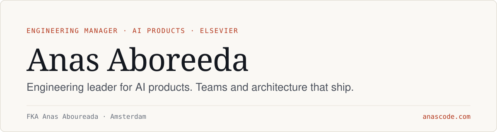

<a href="https://anascode.com">
  <picture>
    <source media="(prefers-color-scheme: dark)" srcset="./assets/header-dark.svg" />
    
  </picture>
</a>

  
  
  
  
  

**Engineering leader for AI products.**

I lead engineering and architecture for LeapSpace at Elsevier, turning AI capabilities into reliable production systems.
We delivered a production beta in six weeks and the full commercial launch in January 2026.
Previously, I owned Scopus Search Query Language parsing, migrated it to ANTLR and built a query-processing pipeline.
Based in Amsterdam.

## What I focus on

- **Engineering leadership:** clear ownership and sound technical judgment, so teams building complex platforms know what they own and why.
- **Architecture at scale:** distributed systems, microservices and cloud platforms that stay maintainable and secure as they grow.
- **AI engineering:** prototypes turned into production systems that are reliable, observable and secure.

## Selected work

- **[LeapSpace: building an AI research platform](https://anascode.com/work#leapspace)** Elsevier, Software Engineering Manager from Jun 2026 
  Formed the team and led delivery of a production beta in six weeks, followed by the full commercial launch in January 2026.
- **[Engineering Village: modernizing research discovery](https://anascode.com/work#engineering-village)** Elsevier, Sep 2022 to Mar 2024 
  Led engineering teams, moved the team from Dayton to Amsterdam and migrated data pipelines to the cloud, improving scalability and traceability.
- **[Scopus: modernizing a legacy platform](https://anascode.com/work#scopus)** Elsevier, Sep 2020 to Aug 2022 
  API responses dropped from about 30 seconds to about 3. Releases moved from monthly to daily.
- **[Zoover: replacing a 15-year-old legacy system](https://anascode.com/work#zoover)** Zoover, Jan 2019 to Sep 2020 
  Average page load fell from 9 seconds to 3.

On GitHub: [Penetration Testing Study Notes](https://github.com/AnasAboreeda/Penetration-Testing-Study-Notes) 

[All work →](https://anascode.com/work)

## Engineering principles

- Simple systems scale better than clever ones.
- Observability is part of the product, not an afterthought.
- Security starts with architecture, not after implementation.
- AI amplifies judgment; it does not replace it.
- Good leadership creates clarity, ownership and room to keep learning.

[How I lead, architect and bring AI to production →](https://anascode.com/approach)

## Toolbox

- **Backend:** Java, Spring Boot, Node.js, TypeScript, Python
- **Frontend:** React, Redux, JavaScript, HTML/CSS
- **AI/ML:** LangChain, LangGraph, LangFlow
- **Architecture:** Microservices, DDD, event-driven systems with Kafka and RabbitMQ
- **Databases:** PostgreSQL, MongoDB, Elasticsearch, Redis, DynamoDB, OracleDB
- **Cloud & DevOps:** AWS, GCP, Kubernetes, Docker, Jenkins, GitHub Actions
- **Observability:** New Relic, Grafana, Prometheus, Kibana

## GitHub metrics

## Amsterdam right now

**Clouds - broken clouds**, 11°C (feels like 10°C), humidity 91%. 
Range 10°C to 11°C · Sunrise 08:04 · Sunset 16:46

---

I write about AI systems, architecture, cloud, backend and engineering leadership. If that overlaps with what you are building or hiring for, [say hello](https://anascode.com/contact). 
Last updated Tuesday, 17 November 2026 at 21:21 CET · [README build](https://github.com/Anasaboreeda/Anasaboreeda/actions/workflows/main.yaml)
